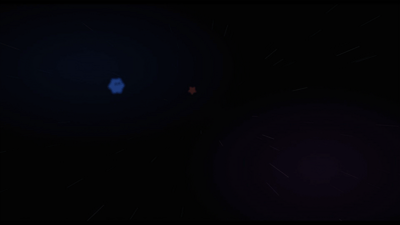
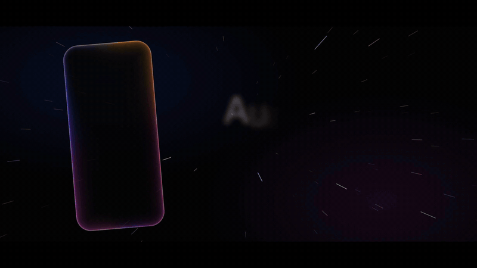
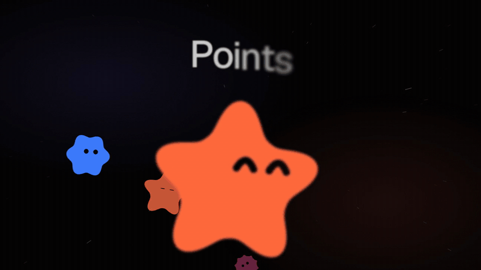
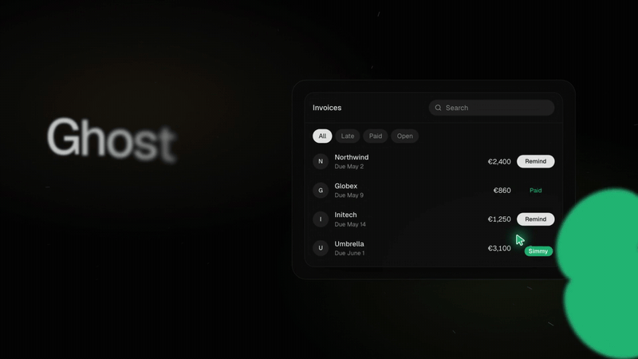
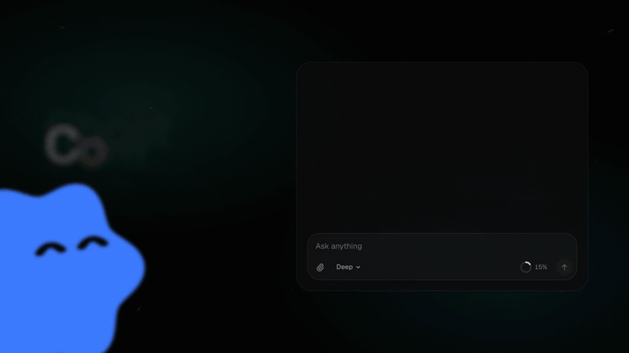
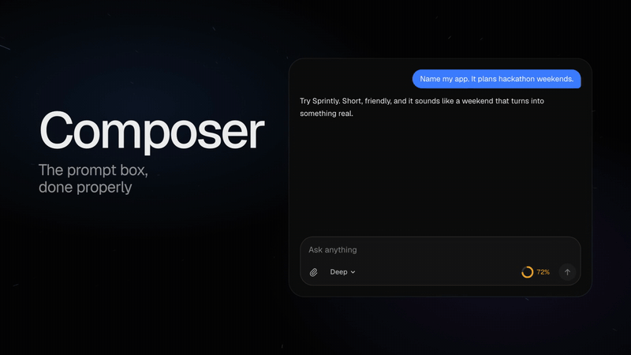

# Fragms



Beautiful ready made components for AI interfaces. Each one is a single React
file you copy into your project and own from then on. No package to install,
no setup, no Tailwind required.

See them live, tune every setting and copy the code at
**[fragms.simonveprek.cz](https://fragms.simonveprek.cz)**.

## Install

Save a file straight into your project. Aura, for example.

```bash
curl --create-dirs -o src/components/aura.tsx https://fragms.simonveprek.cz/source/aura
```

Already set up with shadcn? Every component is in the registry too, and
anything a component needs comes with it.

```bash
npx shadcn@latest add https://fragms.simonveprek.cz/r/aura.json
```

Both always fetch the latest version. To keep a fixed one, fetch it from a
release tag here instead, which never changes once published.

```bash
curl --create-dirs -o src/components/aura.tsx https://raw.githubusercontent.com/simonveprek/fragms/v1.0.0/components/aura.tsx
```

Or just copy the file from the `components` folder. That is all an install is.

## Components

### Aura



A glow on the inside edge of a shape that swells with a voice. Wrap any
element, use it as a shape of its own, or cover the whole screen. Needs React.

```tsx
<Aura level={micLevel} className="rounded-[40px]">
  <Assistant />
</Aura>
```

[Source](components/aura.tsx)

### Points



Little agents with a face that blink, look around, think, talk, listen and
nap. Ten shapes, eight moods, any colour. Needs React.

```tsx
<Point shape="flower" mood={thinking ? "thinking" : "idle"} />
```

[Source](components/points.tsx)

### Ghost



An AI cursor that works your interface for real. Give it steps and it glides,
clicks and types while a small tag says what it is doing. Needs React and
Framer Motion.

```tsx
<Ghost
  steps={[
    { target: "#search", action: "type", text: "May", say: "Looking at May" },
    { target: "#remind", action: "click", say: "Sending a reminder" },
  ]}
>
  <Invoices />
</Ghost>
```

[Source](components/ghost.tsx)

### Composer



The prompt box an AI app needs. It grows as you write, takes files by drop or
paste, picks a model, turns speech into text while Aura glows round its edge,
and turns send into stop while the answer comes in. Needs React, Framer Motion
and `aura.tsx` beside it.

```tsx
<Composer
  onSubmit={({ text, files, model }) => send(text, files, model)}
  busy={answering}
  onStop={stop}
/>
```

[Source](components/composer.tsx)

### Context



A ring that fills as a conversation uses up the model's memory. Hover it for
what takes the room and what the next reply costs. It warns before the model
starts to forget. Needs React.

```tsx
<Context used={84_200} limit={200_000} price={3} />
```

[Source](components/context.tsx)

## Using them

Every file starts with a short guide and an example. Each showcase on the site
lists every setting, what it takes and its default, and has instructions you
can paste into Claude or ChatGPT to wire it up for you.

## Versions

The version sits in the header of each file, and every release is tagged here.
Pin to a tag for a file that never changes, or fetch from the site for the
latest.

## License

[MIT](LICENSE). Use them in anything, change them however you like.

Made by [Šimon Vepřek](https://simonveprek.cz).
